# IPGUI 绘图 API 参考

覆盖 `ESDBox_IPGUI/core/gfx` 的全部绘图能力。每张图只演示一个 API，参数值直接标在图里；图下方的代码就是生成这张图的实际调用。

所有示例画在 1000×420 的 RGBA8888 离屏 surface 上，不使用任何位图素材。

---

## 目录

- [1. 初始化](#init)
- [2. 快速开始](#quickstart)
- [3. 基础类型](#types)
  - [3.1 坐标与几何](#types-geo)
  - [3.2 颜色](#types-color)
  - [3.3 Surface](#types-surf)
  - [3.4 Paint](#types-paint)
- [4. 图元](#primitives)
  - [4.1 像素 ipgui_draw_pixel](#api-pixel)
  - [4.2 直线 ipgui_draw_line_generic](#api-line)
    - [填充源：渐变与图像](#api-line-fill)
  - [4.3 三角形 ipgui_draw_triangle](#api-triangle)
    - [填充源：渐变与图像](#api-triangle-fill)
  - [4.4 实心圆 ipgui_draw_filled_circle](#api-circle)
    - [填充源：渐变与图像](#api-circle-fill)
  - [4.5 圆弧 ipgui_draw_arc](#api-arc)
    - [填充源：渐变与图像](#api-arc-fill)
  - [4.6 多边形 ipgui_draw_polygon](#api-polygon)
  - [4.7 圆角背景 ipgui_draw_box_background](#api-box-bg)
    - [填充源：渐变与图像](#api-box-bg-fill)
  - [4.8 圆角边框 ipgui_draw_box_border](#api-box-border)
    - [填充源：渐变与图像](#api-box-border-fill)
  - [4.9 外阴影 ipgui_draw_box_outer_shadow](#api-shadow)
    - [填充源：渐变与图像](#api-shadow-fill)
  - [4.10 图像 ipgui_draw_image](#api-image)
    - [便捷接口 ipgui_draw_image_at / centered / in_rect](#api-image-api)
    - [平铺 ipgui_draw_image_tiled](#api-image-tiled)
  - [4.11 文字 ipgui_draw_builtin_text](#api-text)
    - [填充源：渐变与图像](#api-text-fill)
    - [文字阴影 ipgui_draw_builtin_text_shadowed](#api-text-shadow)
  - [4.12 图标 ipgui_draw_icon](#api-icon)
    - [便捷接口 ipgui_draw_icon_at / _centered / _in_rect](#api-icon-api)
- [5. 渐变与混合](#gradient-blend)
  - [5.1 渐变](#api-gradient)
  - [5.2 ipgui_blend](#api-blend)
- [6. 蒙版](#mask)
  - [6.1 渐变蒙版](#api-mask)
  - [6.2 内部掩码与模糊](#mask-internal)
- [7. 像素格式](#pixfmt)
- [8. 性能与限制](#perf)

---

<a id="init"></a>
## 1. 初始化

```c
#include "ipgui_core.h"

int main(void)
{
    if (ipgui_init() != IPGUI_ERR_OK) {
        // 内存池不足，见 ipgui_conf.h 的 IPGUI_SMEM_SIZE
        return 1;
    }
    // ... 绘图 ...
}
```

`ipgui_init()` 只初始化内存池与全局表。绘图本身不需要屏幕，也不需要 widget 系统。

---

<a id="quickstart"></a>
## 2. 快速开始

```c
static u8_t fb[800 * 480 * 4];
ipgui_surf_t surf;

surf.surf.start.x = 0;      surf.surf.start.y = 0;
surf.surf.end.x   = 799;    surf.surf.end.y   = 479;
surf.color        = fb;
surf.stride       = 800 * 4;
surf.pix_fmt      = PIX_FMT_RGBA8888;
surf.pix_size     = 4;

ipgui_draw_pixel(&surf, NULL, 10, 10,
                 (ipgui_color_t){0xFF, 0x00, 0x00, 255}, 255, 255,
                 IPGUI_BLEND_NORMAL);
```

`clip` 传 `NULL` 表示不裁剪。

`fb` 是画布内存本身，不是"屏幕句柄"：一个 `800 × 480 × 4` 字节的数组，每个像素按 RGBA8888 存 4 个字节，`surf.color` 指向它的首地址，`stride = 800 * 4` 是每行字节数。绘图 API 只往这块内存里写像素，写完之后怎么显示由你自己决定：

- 桌面 / SDL 移植：画完把 `fb` 整块或按脏矩形拷到窗口缓冲；
- 本手册的示例图：就是画进 `fb`，再整块导出成 PNG；
- MCU 上一般不开整屏 `fb`，而是把 surface 指向一条 PFB 条带（例如 800×40）分片渲染，见[第 8 节](#perf)。

`fb` 的生命周期必须覆盖整个绘图过程，不要用已经出作用域的局部数组去初始化 `surf.color`。

---

<a id="types"></a>
## 3. 基础类型

<a id="types-geo"></a>
### 3.1 坐标与几何

```c
ipgui_point_t  p;      // { x, y }
ipgui_line_t   line;   // { start, end }
ipgui_aabb_t   box;    // { start, end }，闭区间
ipgui_spoint_t sp;     // 26.6 定点，用于 spolygon
```

<a id="types-color"></a>
### 3.2 颜色

```c
ipgui_color_t c;
IPGUI_COLOR_SET(c, 255, 0xFF0000);   // alpha, RGB
c.r = 0xFF; c.g = 0x00; c.b = 0x00; c.a = 255;
```

<a id="types-surf"></a>
### 3.3 Surface

| 字段 | 含义 |
|---|---|
| `surf` | 覆盖的屏幕区域（绝对坐标） |
| `color` | 首像素地址 |
| `stride` | 每行字节数 |
| `pix_fmt` | 像素格式枚举 |
| `pix_size` | 每像素字节数 |

<a id="types-paint"></a>
### 3.4 Paint

所有填充类 API 都通过 `ipgui_paint_t` 决定画什么：

```c
typedef struct {
    ipgui_paint_type_t type;          // COLOR / GRADIENT / IMAGE
    union {
        ipgui_color_t      color;
        ipgui_grad_src_t   grad_src;  // grad_type + liner/radial/conic
        ipgui_image_src_t  image_src;
    } src;
} ipgui_paint_t;
```

---

<a id="primitives"></a>
## 4. 图元

每节代码块都是独立的，复制到自己工程里即可编译。唯一的前提是已经有一个 `ipgui_surf_t surf`（创建方法见[第 2 节](#quickstart)）。

「填充源」小节的示例图统一用图像处理的标准测试图 **Lena**（裁成 220×220 的 RGBA8888）。代码里的 `img_buf` 就是这块像素缓冲，换成你自己的图像即可。

<a id="api-pixel"></a>
### 4.1 像素 `ipgui_draw_pixel`

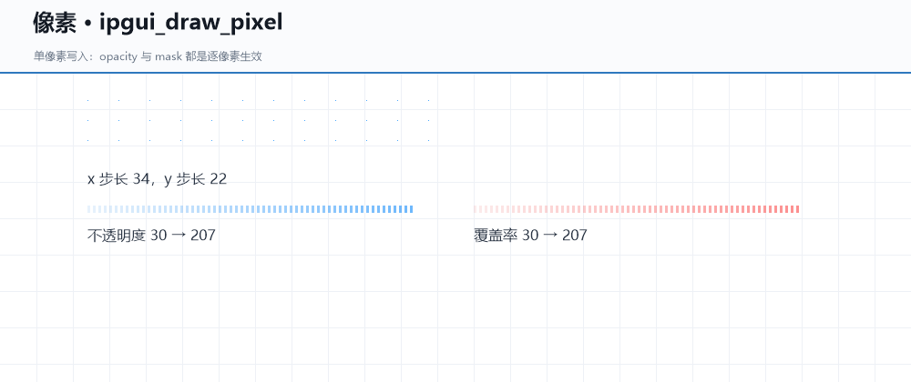

```c
/* 上：3 行 x 12 列点阵，x 步长 34，y 步长 22 */
for (int row = 0; row < 3; row++)
    for (int col = 0; col < 12; col++)
        ipgui_draw_pixel(&surf, NULL, 96 + col * 34, 110 + row * 22,
                         (ipgui_color_t){0x4E, 0xAA, 0xFF, 255}, 255, 255,
                         IPGUI_BLEND_NORMAL);

/* 左下：60 组竖条，每组 3px 宽、8px 高，opacity 30 -> 207 */
for (int i = 0; i < 60; i++)
    for (int y = 0; y < 8; y++)
        for (int x = 0; x < 3; x++)
            ipgui_draw_pixel(&surf, NULL, 96 + i * 6 + x, 226 + y,
                             (ipgui_color_t){0x4E, 0xAA, 0xFF, 255}, 255,
                             30 + i * 3, IPGUI_BLEND_NORMAL);

/* 右下：同样的几何，改的是 mask，30 -> 207 */
for (int i = 0; i < 60; i++)
    for (int y = 0; y < 8; y++)
        for (int x = 0; x < 3; x++)
            ipgui_draw_pixel(&surf, NULL, 520 + i * 6 + x, 226 + y,
                             (ipgui_color_t){0xFF, 0x78, 0x78, 255}, 30 + i * 3,
                             255, IPGUI_BLEND_NORMAL);
```

| 参数 | 说明 |
|---|---|
| `mask` | 0–255 覆盖率，255 = 实心 |
| `opacity` | 0–255 整体不透明度 |

两者效果接近但语义不同：`mask` 是图形覆盖率（抗锯齿用），`opacity` 是图层透明度。

> `ipgui_draw_pixel` 只接受 `ipgui_color_t`，没有 paint 参数，**不支持渐变/图像填充**。需要渐变或贴图时用 `ipgui_blend()`（见 5.2）。

---

<a id="api-line"></a>
### 4.2 直线 `ipgui_draw_line_generic`

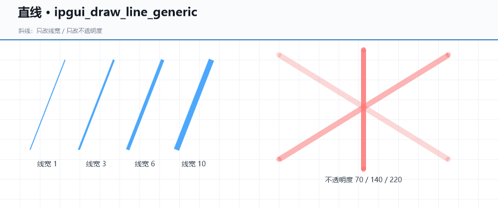

```c
ipgui_line_t       ln;
ipgui_line_style_t st;

memset(&st, 0, sizeof(st));
st.paint.type      = IPGUI_PAINT_COLOR;
IPGUI_COLOR_SET(st.paint.src.color, 255, 0x4EAAFF);
st.blend_mode      = IPGUI_BLEND_NORMAL;

/* 左：四条同角度斜线，只改 width */
st.cap     = IPGUI_LINE_CAP_BUTT;
st.opacity = 255;

int widths[4] = { 1, 3, 6, 10 };

for (int i = 0; i < 4; i++) {
    ln.start.x = 60 + i * 98;
    ln.start.y = 300;
    ln.end.x   = ln.start.x + 70;    /* 水平位移  70 */
    ln.end.y   = 120;                /* 垂直位移 -180 */
    st.width   = widths[i];
    ipgui_draw_line_generic(&surf, NULL, &ln, &st);
}

/* 右：三条交叉斜线，只改 opacity，交叉处叠加变深 */
IPGUI_COLOR_SET(st.paint.src.color, 255, 0xFF7878);
st.width = 10;
st.cap   = IPGUI_LINE_CAP_ROUND;

st.opacity = 70;
ln.start.x = 560; ln.start.y = 110;
ln.end.x   = 900; ln.end.y   = 320;
ipgui_draw_line_generic(&surf, NULL, &ln, &st);

st.opacity = 140;
ln.start.x = 560; ln.start.y = 320;
ln.end.x   = 900; ln.end.y   = 110;
ipgui_draw_line_generic(&surf, NULL, &ln, &st);

st.opacity = 220;
ln.start.x = 730; ln.start.y = 100;
ln.end.x   = 730; ln.end.y   = 340;
ipgui_draw_line_generic(&surf, NULL, &ln, &st);
```

| 字段 | 说明 |
|---|---|
| `width` | 线宽（像素） |
| `cap` | `IPGUI_LINE_CAP_BUTT` / `IPGUI_LINE_CAP_ROUND` |
| `paint` | 纯色或渐变 |
| `opacity` / `blend_mode` | 混合参数 |

另有 `ipgui_draw_line_classic()`：纯 Bresenham 单像素线，**忽略 width**，适合表格线。

<a id="api-line-fill"></a>
#### 填充源：渐变与图像

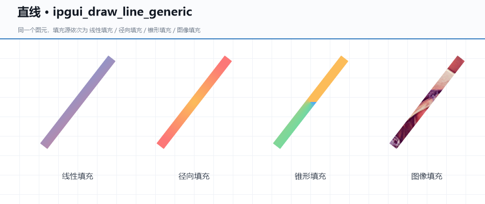

`style.paint` 不限于纯色。同一根线画两次，只换 paint：

```c
ipgui_line_t       ln;
ipgui_line_style_t st;
ipgui_gradient_color_stop_t s0, s1;

ln.start.x = 90;   ln.start.y = 300;
ln.end.x   = 230;  ln.end.y   = 120;

memset(&st, 0, sizeof(st));
st.width      = 18;
st.cap        = IPGUI_LINE_CAP_BUTT;
st.opacity    = 255;
st.blend_mode = IPGUI_BLEND_NORMAL;

/* ① 线性渐变 */
ipgui_liner_gradient_color_t lg;
ipgui_liner_gradient_init_direct(&lg, 70, 120, 250, 300);
IPGUI_COLOR_SET(s0.color, 255, 0x4EAAFF);  s0.pos = 0;
IPGUI_COLOR_SET(s1.color, 255, 0xFF7878);  s1.pos = 255;
ipgui_liner_gradient_add_stop(&lg, &s0);
ipgui_liner_gradient_add_stop(&lg, &s1);

st.paint.type = IPGUI_PAINT_GRADIENT;
st.paint.src.grad_src.grad_type = IPGUI_GRADIENT_TYPE_LINEAR;
st.paint.src.grad_src.grad.liner_grad = lg;
ipgui_draw_line_generic(&surf, NULL, &ln, &st);

/* ② 图像填充：img_aabb 是这条线要覆盖的屏幕矩形 */
ipgui_image_src_t isrc;
ipgui_aabb_t      ibox;

ibox.start.x = 300;  ibox.start.y = 110;
ibox.end.x   = 500;  ibox.end.y   = 310;

isrc.img_aabb  = &ibox;
isrc.stride    = 220 * 4;
isrc.buf       = img_buf;
isrc.img_pxfmt = IPGUI_IMG_FMT_RGBA8888;
isrc.px_size   = 4;

st.paint.type = IPGUI_PAINT_IMAGE;
st.paint.src.image_src = isrc;

ln.start.x += 240;  ln.end.x += 240;
ipgui_draw_line_generic(&surf, NULL, &ln, &st);
```

径向 / 锥形只是把 `init` 换成 `ipgui_radial_gradient_init` / `ipgui_conic_gradient_init`，再把 `grad_type` 与 union 成员换成对应那个。

---

<a id="api-triangle"></a>
### 4.3 三角形 `ipgui_draw_triangle`

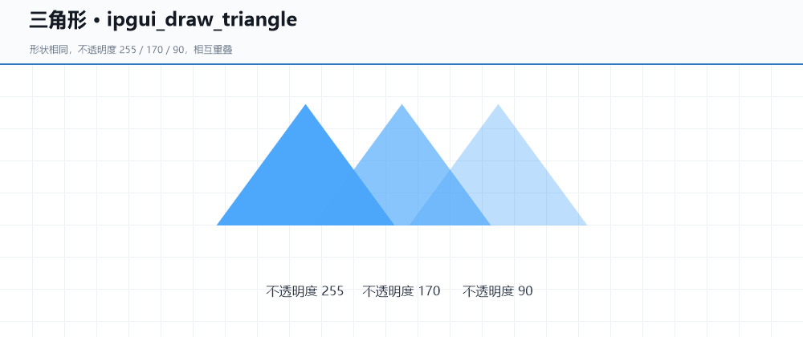

```c
ipgui_point_t          p1, p2, p3;
ipgui_triangle_style_t st;

memset(&st, 0, sizeof(st));
st.paint.type      = IPGUI_PAINT_COLOR;
IPGUI_COLOR_SET(st.paint.src.color, 255, 0x4EAAFF);
st.blend_mode      = IPGUI_BLEND_NORMAL;

int cx[3] = { 380, 500, 620 };
int op[3] = { 255, 170, 90 };

for (int i = 0; i < 3; i++) {
    p1.x = cx[i];         p1.y = 130;
    p2.x = cx[i] + 110;   p2.y = 280;
    p3.x = cx[i] - 110;   p3.y = 280;
    st.opacity = op[i];
    ipgui_draw_triangle(&surf, NULL, &p1, &p2, &p3, &st);
}
```

三个三角形形状相同、横向间距 120，宽 220，所以彼此重叠约一半；opacity 从 255 降到 90，重叠区的叠色依次变浅。

<a id="api-triangle-fill"></a>
#### 填充源：渐变与图像

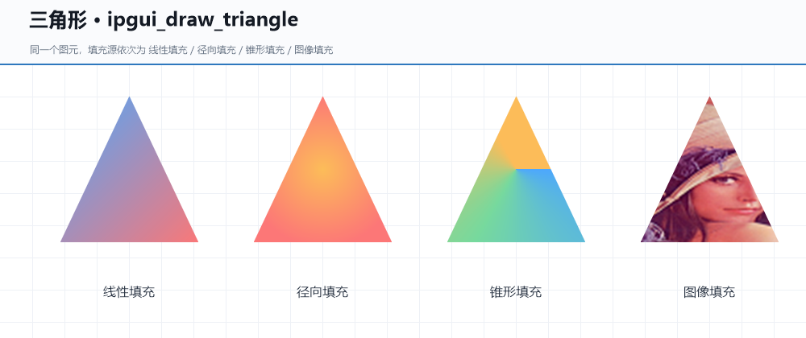

```c
ipgui_point_t          p1, p2, p3;
ipgui_triangle_style_t st;
ipgui_gradient_color_stop_t s0, s1;

p1.x = 160;  p1.y = 120;
p2.x = 245;  p2.y = 300;
p3.x = 75;   p3.y = 300;

memset(&st, 0, sizeof(st));
st.opacity    = 255;
st.blend_mode = IPGUI_BLEND_NORMAL;

/* ① 线性渐变 */
ipgui_liner_gradient_color_t lg;
ipgui_liner_gradient_init_direct(&lg, 70, 120, 250, 300);
IPGUI_COLOR_SET(s0.color, 255, 0x4EAAFF);  s0.pos = 0;
IPGUI_COLOR_SET(s1.color, 255, 0xFF7878);  s1.pos = 255;
ipgui_liner_gradient_add_stop(&lg, &s0);
ipgui_liner_gradient_add_stop(&lg, &s1);

st.paint.type = IPGUI_PAINT_GRADIENT;
st.paint.src.grad_src.grad_type = IPGUI_GRADIENT_TYPE_LINEAR;
st.paint.src.grad_src.grad.liner_grad = lg;
ipgui_draw_triangle(&surf, NULL, &p1, &p2, &p3, &st);

/* ② 图像填充 */
ipgui_image_src_t isrc;
ipgui_aabb_t      ibox;

ibox.start.x = 300;  ibox.start.y = 110;
ibox.end.x   = 500;  ibox.end.y   = 310;

isrc.img_aabb  = &ibox;
isrc.stride    = 220 * 4;
isrc.buf       = img_buf;
isrc.img_pxfmt = IPGUI_IMG_FMT_RGBA8888;
isrc.px_size   = 4;

st.paint.type = IPGUI_PAINT_IMAGE;
st.paint.src.image_src = isrc;

p1.x += 240;  p2.x += 240;  p3.x += 240;
ipgui_draw_triangle(&surf, NULL, &p1, &p2, &p3, &st);
```

---

<a id="api-circle"></a>
### 4.4 实心圆 `ipgui_draw_filled_circle`

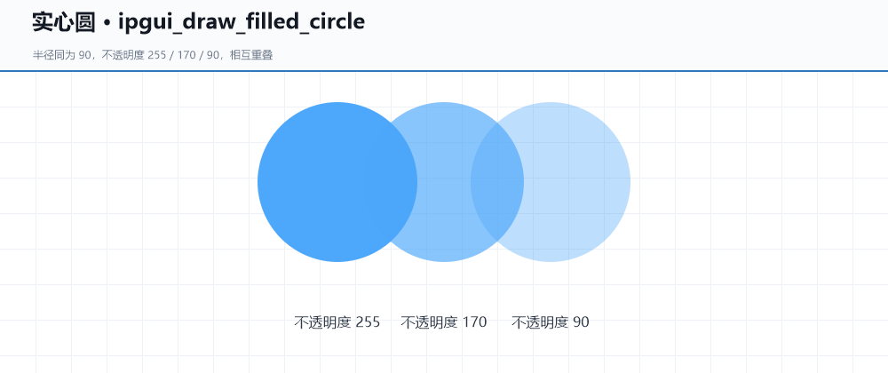

```c
ipgui_filled_circle_style_t st;

memset(&st, 0, sizeof(st));
st.paint.type      = IPGUI_PAINT_COLOR;
IPGUI_COLOR_SET(st.paint.src.color, 255, 0x4EAAFF);
st.blend_mode      = IPGUI_BLEND_NORMAL;

int cx[3] = { 380, 500, 620 };
int op[3] = { 255, 170, 90 };

for (int i = 0; i < 3; i++) {
    st.opacity = op[i];
    ipgui_draw_filled_circle(&surf, NULL, cx[i], 205, 90, &st);
}
```

半径都是 90，圆心间距 120，所以相邻两个圆重叠；重叠处能直接看到 alpha 混合。

> 圆环不要用两个圆叠加，用 `ipgui_draw_arc()` 指定内外半径。

<a id="api-circle-fill"></a>
#### 填充源：渐变与图像

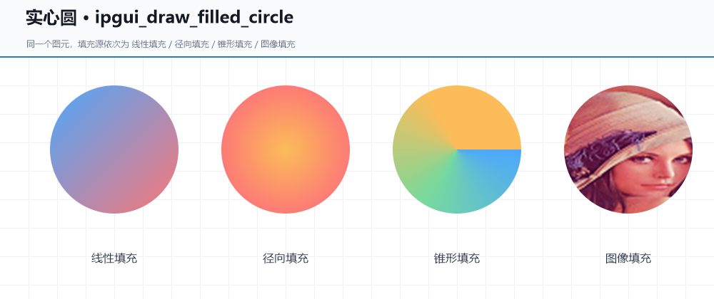

```c
ipgui_filled_circle_style_t st;
ipgui_gradient_color_stop_t s0, s1;

memset(&st, 0, sizeof(st));
st.opacity    = 255;
st.blend_mode = IPGUI_BLEND_NORMAL;

/* ① 线性渐变 */
ipgui_liner_gradient_color_t lg;
ipgui_liner_gradient_init_direct(&lg, 70, 120, 250, 300);
IPGUI_COLOR_SET(s0.color, 255, 0x4EAAFF);  s0.pos = 0;
IPGUI_COLOR_SET(s1.color, 255, 0xFF7878);  s1.pos = 255;
ipgui_liner_gradient_add_stop(&lg, &s0);
ipgui_liner_gradient_add_stop(&lg, &s1);

st.paint.type = IPGUI_PAINT_GRADIENT;
st.paint.src.grad_src.grad_type = IPGUI_GRADIENT_TYPE_LINEAR;
st.paint.src.grad_src.grad.liner_grad = lg;
ipgui_draw_filled_circle(&surf, NULL, 160, 210, 90, &st);

/* ② 图像填充 */
ipgui_image_src_t isrc;
ipgui_aabb_t      ibox;

ibox.start.x = 300;  ibox.start.y = 110;
ibox.end.x   = 500;  ibox.end.y   = 310;

isrc.img_aabb  = &ibox;
isrc.stride    = 220 * 4;
isrc.buf       = img_buf;
isrc.img_pxfmt = IPGUI_IMG_FMT_RGBA8888;
isrc.px_size   = 4;

st.paint.type = IPGUI_PAINT_IMAGE;
st.paint.src.image_src = isrc;
ipgui_draw_filled_circle(&surf, NULL, 400, 210, 90, &st);
```

---

<a id="api-arc"></a>
### 4.5 圆弧 `ipgui_draw_arc`

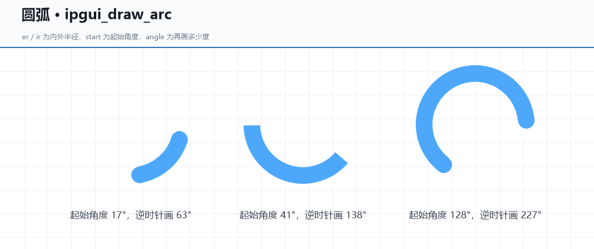

```c
int starts[3]   = { 17, 41, 128 };   /* 起始角度（度） */
int angles[3]   = { 63, 138, 227 };  /* 再逆时针画多少度 */
int round_cap[3] = { 1, 0, 1 };      /* 1 = 圆头端点, 0 = 平头端点 */

for (int i = 0; i < 3; i++) {
    ipgui_arc_t       a;
    ipgui_arc_style_t st;

    a.cx    = 220 + i * 290;
    a.cy    = 210;
    a.er    = 100;      /* 外半径 */
    a.ir    = 72;       /* 内半径，环宽 28 */
    a.start = (ipgui_arc_angle_t)starts[i];
    a.dir   = IPGUI_ARC_DRAW_DIR_CCW;
    a.angle = (u16_t)angles[i];

    memset(&st, 0, sizeof(st));
    st.paint.type = IPGUI_PAINT_COLOR;
    IPGUI_COLOR_SET(st.paint.src.color, 255, 0x4EAAFF);
    st.opacity = 255;
    st.sep_type = round_cap[i] ? IPGUI_ARC_ENDPOINT_TYPE_ROUND
                               : IPGUI_ARC_ENDPOINT_TYPE_BUTT;
    st.eep_type = st.sep_type;
    st.blend_mode = IPGUI_BLEND_NORMAL;

    ipgui_draw_arc(&surf, NULL, &a, &st);
}
```

三段圆弧分别是：起始角度 17°，逆时针画 63°；起始角度 41°，逆时针画 138°；起始角度 128°，逆时针画 227°。起止角都没有落在 90° 的整数倍上，端点切在象限中间，端帽形状和边缘抗锯齿都能直接看出来；中间那条用平头端点，两侧用圆头端点。

| 字段 | 说明 |
|---|---|
| `er / ir` | 外半径 / 内半径，`er - ir` 为环宽 |
| `start` | 起始角度（度） |
| `dir` | `CCW` 逆时针 / `CW` 顺时针 |
| `angle` | 从起始角度再画多少度，360 为整圈 |

`ipgui_draw_arc_thin()` 是固定 1px 的简化版本，参数直接传坐标，不需要填结构体。

<a id="api-arc-fill"></a>
#### 填充源：渐变与图像

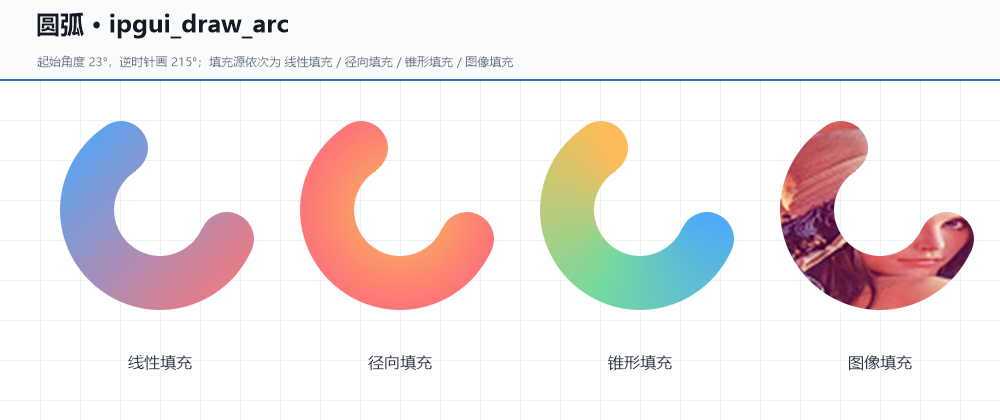

```c
ipgui_arc_t       a;
ipgui_arc_style_t st;
ipgui_gradient_color_stop_t s0, s1;

a.cx = 160; a.cy = 210;
a.er = 100; a.ir = 46;
a.start = 23;                              /* 起始角度 23° */
a.dir   = IPGUI_ARC_DRAW_DIR_CCW;          /* 逆时针 */
a.angle = 215;                             /* 再画 215° */

memset(&st, 0, sizeof(st));
st.sep_type   = IPGUI_ARC_ENDPOINT_TYPE_ROUND;
st.eep_type   = IPGUI_ARC_ENDPOINT_TYPE_ROUND;
st.opacity    = 255;
st.blend_mode = IPGUI_BLEND_NORMAL;

/* ① 线性渐变 */
ipgui_liner_gradient_color_t lg;
ipgui_liner_gradient_init_direct(&lg, 70, 120, 250, 300);
IPGUI_COLOR_SET(s0.color, 255, 0x4EAAFF);  s0.pos = 0;
IPGUI_COLOR_SET(s1.color, 255, 0xFF7878);  s1.pos = 255;
ipgui_liner_gradient_add_stop(&lg, &s0);
ipgui_liner_gradient_add_stop(&lg, &s1);

st.paint.type = IPGUI_PAINT_GRADIENT;
st.paint.src.grad_src.grad_type = IPGUI_GRADIENT_TYPE_LINEAR;
st.paint.src.grad_src.grad.liner_grad = lg;
ipgui_draw_arc(&surf, NULL, &a, &st);

/* ② 图像填充 */
ipgui_image_src_t isrc;
ipgui_aabb_t      ibox;

ibox.start.x = 300;  ibox.start.y = 110;
ibox.end.x   = 500;  ibox.end.y   = 310;

isrc.img_aabb  = &ibox;
isrc.stride    = 220 * 4;
isrc.buf       = img_buf;
isrc.img_pxfmt = IPGUI_IMG_FMT_RGBA8888;
isrc.px_size   = 4;

st.paint.type = IPGUI_PAINT_IMAGE;
st.paint.src.image_src = isrc;

a.cx += 240;
ipgui_draw_arc(&surf, NULL, &a, &st);
```

四联图的圆弧都是起始角度 23°，逆时针画 215°，只换 `st.paint` 的填充源。

---

<a id="api-polygon"></a>
### 4.6 多边形 `ipgui_draw_polygon`

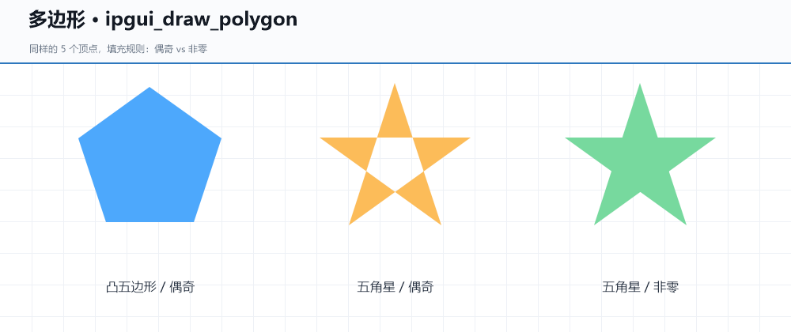

```c
#include <math.h>

ipgui_point_t             v[5];
ipgui_polygon_ras_t       ras;
ipgui_polygon_style_t     attr;

memset(&ras, 0, sizeof(ras));
ipgui_polygon_ras_init(&ras);

memset(&attr, 0, sizeof(attr));
IPGUI_COLOR_SET(attr.color, 255, 0x4EAAFF);
attr.alpha = 255;
attr.blend_mode = IPGUI_BLEND_NORMAL;

/* 左：凸五边形，五个顶点按角度均匀分布 */
for (int i = 0; i < 5; i++) {
    double a = -1.5708 + i * 2.0 * 3.1415926 / 5.0;
    v[i].x = 190 + 95 * cos(a);
    v[i].y = 205 + 95 * sin(a);
}
ipgui_polygon_ras_set_fill_rule(&ras, IPGUI_FILL_RULE_EVENODD);
IPGUI_COLOR_SET(attr.color, 255, 0x4EAAFF);
ipgui_draw_polygon(&surf, NULL, v, 5, &ras, &attr);

/* 中：五角星，顶点按 0,2,4,1,3 的顺序连才是自相交 */
for (int i = 0; i < 5; i++) {
    double a = -1.5708 + (i * 2 % 5) * 2.0 * 3.1415926 / 5.0;
    v[i].x = 500 + 100 * cos(a);
    v[i].y = 205 + 100 * sin(a);
}
ipgui_polygon_ras_set_fill_rule(&ras, IPGUI_FILL_RULE_EVENODD);
IPGUI_COLOR_SET(attr.color, 255, 0xFFBE5A);
ipgui_draw_polygon(&surf, NULL, v, 5, &ras, &attr);

/* 右：同样五个顶点，换成非零环绕，中心会被填满 */
for (int i = 0; i < 5; i++) {
    double a = -1.5708 + (i * 2 % 5) * 2.0 * 3.1415926 / 5.0;
    v[i].x = 810 + 100 * cos(a);
    v[i].y = 205 + 100 * sin(a);
}
ipgui_polygon_ras_set_fill_rule(&ras, IPGUI_FILL_RULE_NONZERO);
IPGUI_COLOR_SET(attr.color, 255, 0x78DCA0);
ipgui_draw_polygon(&surf, NULL, v, 5, &ras, &attr);
```

| 参数 | 说明 |
|---|---|
| `p` | 顶点数组，必须按轮廓顺序 |
| `num` | 顶点数，≥ 3 |
| `ras` | 光栅化上下文 |
| `attr.color / alpha` | 填充色与不透明度 |

> **实测限制**：顶点数受 `EDGE_EMBED_NUM` 限制；边过于接近水平时报 `edge too flat` 并放弃本次绘制。复杂轮廓建议拆成多个简单多边形。

> `ipgui_polygon_style_t` 只有 `color` / `alpha`，**不支持 paint**。需要渐变填充的多边形，可先用 `ipgui_draw_polygon` 生成覆盖区域，或改用三角形拆分后逐个用 `ipgui_draw_triangle`（它支持渐变）。

---

<a id="api-box-bg"></a>
### 4.7 圆角背景 `ipgui_draw_box_background`

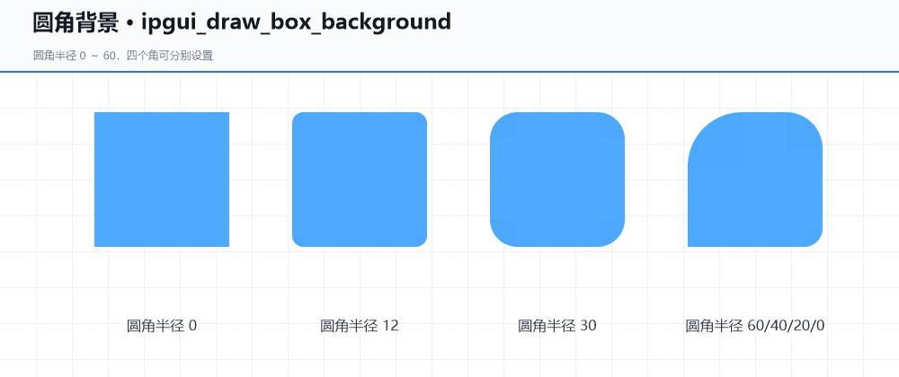

```c
/* 左上 / 右上 / 右下 / 左下 */
int radius[4][4] = {
    {  0,  0,  0,  0 },
    { 12, 12, 12, 12 },
    { 30, 30, 30, 30 },
    { 60, 40, 20,  0 },
};

for (int i = 0; i < 4; i++) {
    ipgui_aabb_t           box;
    ipgui_box_style_t      bs;
    ipgui_box_bg_style_t   bg;

    box.start.x = 180 + i * 220 - 75;
    box.start.y = 135;
    box.end.x   = box.start.x + 149;   /* 150 x 150 */
    box.end.y   = box.start.y + 149;

    memset(&bs, 0, sizeof(bs));
    bs.left_top_radius     = radius[i][0];
    bs.right_top_radius    = radius[i][1];
    bs.right_bottom_radius = radius[i][2];
    bs.left_bottom_radius  = radius[i][3];

    memset(&bg, 0, sizeof(bg));
    bg.paint.type      = IPGUI_PAINT_COLOR;
    IPGUI_COLOR_SET(bg.paint.src.color, 255, 0x4EAAFF);
    bg.opacity         = 255;
    bg.blend_mode      = IPGUI_BLEND_NORMAL;

    ipgui_draw_box_background(&surf, NULL, &box, &bs, &bg);
}
```

`bg.paint` 可以是纯色、渐变或图像。四个半径分别对应左上、右上、右下、左下；半径取到短边一半时退化为圆。

<a id="api-box-bg-fill"></a>
#### 填充源：渐变与图像

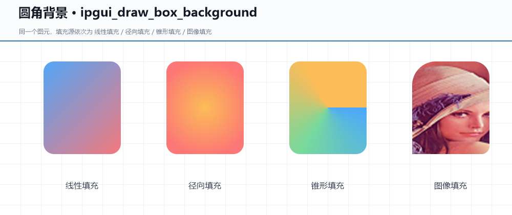

```c
ipgui_aabb_t         box;
ipgui_box_style_t    bs;
ipgui_box_bg_style_t bg;
ipgui_gradient_color_stop_t s0, s1;

box.start.x = 85;   box.start.y = 120;
box.end.x   = 235;  box.end.y   = 300;

memset(&bs, 0, sizeof(bs));
bs.left_top_radius = 20;  bs.right_top_radius = 20;
bs.left_bottom_radius = 20;  bs.right_bottom_radius = 20;

memset(&bg, 0, sizeof(bg));
bg.opacity    = 255;
bg.blend_mode = IPGUI_BLEND_NORMAL;

/* ① 线性渐变 */
ipgui_liner_gradient_color_t lg;
ipgui_liner_gradient_init_direct(&lg, 70, 120, 250, 300);
IPGUI_COLOR_SET(s0.color, 255, 0x4EAAFF);  s0.pos = 0;
IPGUI_COLOR_SET(s1.color, 255, 0xFF7878);  s1.pos = 255;
ipgui_liner_gradient_add_stop(&lg, &s0);
ipgui_liner_gradient_add_stop(&lg, &s1);

bg.paint.type = IPGUI_PAINT_GRADIENT;
bg.paint.src.grad_src.grad_type = IPGUI_GRADIENT_TYPE_LINEAR;
bg.paint.src.grad_src.grad.liner_grad = lg;
ipgui_draw_box_background(&surf, NULL, &box, &bs, &bg);

/* ② 图像填充 */
ipgui_image_src_t isrc;
ipgui_aabb_t      ibox;

ibox.start.x = 300;  ibox.start.y = 110;
ibox.end.x   = 500;  ibox.end.y   = 310;

isrc.img_aabb  = &ibox;
isrc.stride    = 220 * 4;
isrc.buf       = img_buf;
isrc.img_pxfmt = IPGUI_IMG_FMT_RGBA8888;
isrc.px_size   = 4;

bg.paint.type = IPGUI_PAINT_IMAGE;
bg.paint.src.image_src = isrc;

/* 图像填充这一组换成四角不同的半径 */
bs.left_top_radius     = 46;
bs.right_top_radius    = 30;
bs.right_bottom_radius = 15;
bs.left_bottom_radius  = 0;

box.start.x = 325;  box.end.x = 475;
ipgui_draw_box_background(&surf, NULL, &box, &bs, &bg);
```

---

<a id="api-box-border"></a>
### 4.8 圆角边框 `ipgui_draw_box_border`

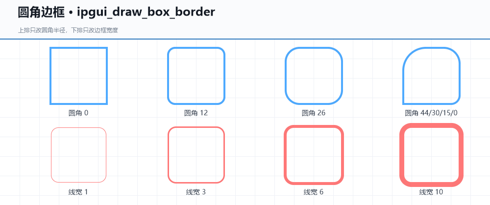

```c
/* 左上 / 右上 / 右下 / 左下 */
int radius[4][4] = {
    {  0,  0,  0,  0 },
    { 12, 12, 12, 12 },
    { 26, 26, 26, 26 },
    { 44, 30, 15,  0 },
};
int width[4]  = { 1, 3, 6, 10 };

/* 上排：只改圆角半径，边框宽度固定 4 */
for (int i = 0; i < 4; i++) {
    ipgui_aabb_t             box;
    ipgui_box_style_t        bs;
    ipgui_box_border_style_t st;

    box.start.x = 160 + i * 240 - 55;
    box.start.y = 100;
    box.end.x   = box.start.x + 110;
    box.end.y   = box.start.y + 110;

    memset(&bs, 0, sizeof(bs));
    bs.left_top_radius     = radius[i][0];
    bs.right_top_radius    = radius[i][1];
    bs.right_bottom_radius = radius[i][2];
    bs.left_bottom_radius  = radius[i][3];

    memset(&st, 0, sizeof(st));
    st.paint.type = IPGUI_PAINT_COLOR;
    IPGUI_COLOR_SET(st.paint.src.color, 255, 0x4EAAFF);
    st.width      = 4;
    st.opacity    = 255;
    st.blend_mode = IPGUI_BLEND_NORMAL;

    ipgui_draw_box_border(&surf, NULL, &box, &bs, &st);
}

/* 下排：只改边框宽度，圆角固定 14 */
for (int i = 0; i < 4; i++) {
    ipgui_aabb_t             box;
    ipgui_box_style_t        bs;
    ipgui_box_border_style_t st;

    box.start.x = 160 + i * 240 - 55;
    box.start.y = 262;
    box.end.x   = box.start.x + 110;
    box.end.y   = box.start.y + 110;

    memset(&bs, 0, sizeof(bs));
    bs.left_top_radius     = 14;
    bs.right_top_radius    = 14;
    bs.left_bottom_radius  = 14;
    bs.right_bottom_radius = 14;

    memset(&st, 0, sizeof(st));
    st.paint.type = IPGUI_PAINT_COLOR;
    IPGUI_COLOR_SET(st.paint.src.color, 255, 0xFF7878);
    st.width      = width[i];
    st.opacity    = 255;
    st.blend_mode = IPGUI_BLEND_NORMAL;

    ipgui_draw_box_border(&surf, NULL, &box, &bs, &st);
}
```

只画环，不填充内部，因此可以叠在任意背景上。`paint` 支持渐变。

<a id="api-box-border-fill"></a>
#### 填充源：渐变与图像

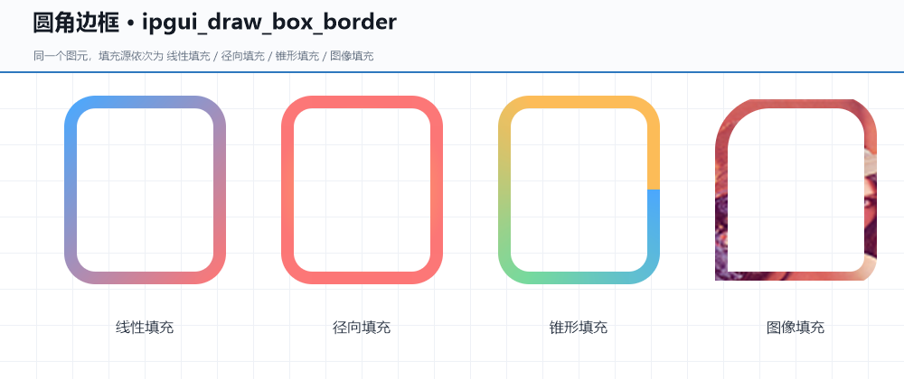

```c
ipgui_aabb_t                 box;
ipgui_box_style_t            bs;
ipgui_box_border_style_t     st;
ipgui_gradient_color_stop_t  s0, s1;

box.start.x = 85;   box.start.y = 120;
box.end.x   = 235;  box.end.y   = 300;

memset(&bs, 0, sizeof(bs));
bs.left_top_radius = 20;  bs.right_top_radius = 20;
bs.left_bottom_radius = 20;  bs.right_bottom_radius = 20;

memset(&st, 0, sizeof(st));
st.width      = 14;
st.opacity    = 255;
st.blend_mode = IPGUI_BLEND_NORMAL;

/* ① 线性渐变 */
ipgui_liner_gradient_color_t lg;
ipgui_liner_gradient_init_direct(&lg, 70, 120, 250, 300);
IPGUI_COLOR_SET(s0.color, 255, 0x4EAAFF);  s0.pos = 0;
IPGUI_COLOR_SET(s1.color, 255, 0xFF7878);  s1.pos = 255;
ipgui_liner_gradient_add_stop(&lg, &s0);
ipgui_liner_gradient_add_stop(&lg, &s1);

st.paint.type = IPGUI_PAINT_GRADIENT;
st.paint.src.grad_src.grad_type = IPGUI_GRADIENT_TYPE_LINEAR;
st.paint.src.grad_src.grad.liner_grad = lg;
ipgui_draw_box_border(&surf, NULL, &box, &bs, &st);

/* ② 图像填充 */
ipgui_image_src_t isrc;
ipgui_aabb_t      ibox;

ibox.start.x = 300;  ibox.start.y = 110;
ibox.end.x   = 500;  ibox.end.y   = 310;

isrc.img_aabb  = &ibox;
isrc.stride    = 220 * 4;
isrc.buf       = img_buf;
isrc.img_pxfmt = IPGUI_IMG_FMT_RGBA8888;
isrc.px_size   = 4;

st.paint.type = IPGUI_PAINT_IMAGE;
st.paint.src.image_src = isrc;

/* 图像填充这一组换成四角不同的半径 */
bs.left_top_radius     = 46;
bs.right_top_radius    = 30;
bs.right_bottom_radius = 15;
bs.left_bottom_radius  = 0;

box.start.x = 325;  box.end.x = 475;
ipgui_draw_box_border(&surf, NULL, &box, &bs, &st);
```

---

<a id="api-shadow"></a>
### 4.9 外阴影 `ipgui_draw_box_outer_shadow`

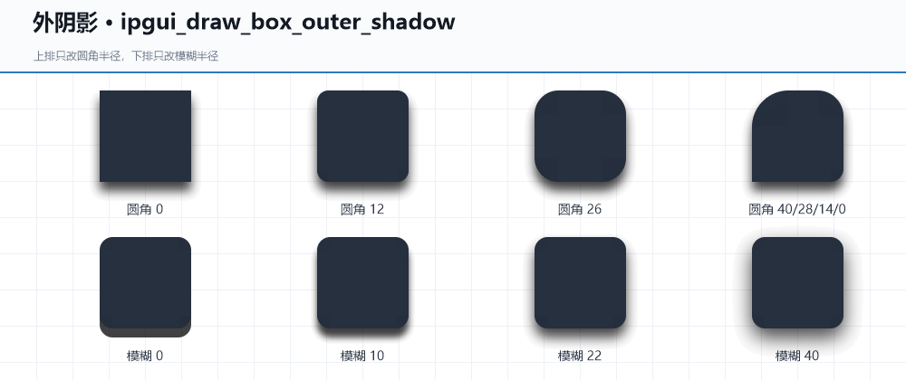

```c
/* 左上 / 右上 / 右下 / 左下 */
int radius[4][4] = {
    {  0,  0,  0,  0 },
    { 12, 12, 12, 12 },
    { 26, 26, 26, 26 },
    { 40, 28, 14,  0 },
};
int blur[4]   = { 0, 10, 22, 40 };

/* 上排：只改圆角半径，blur 固定 18 */
for (int i = 0; i < 4; i++) {
    ipgui_aabb_t                    box;
    ipgui_box_style_t               bs;
    ipgui_box_outer_shadow_style_t  sh;
    ipgui_box_bg_style_t            bg;

    box.start.x = 160 + i * 240 - 50;
    box.start.y = 100;
    box.end.x   = box.start.x + 100;
    box.end.y   = box.start.y + 100;

    memset(&bs, 0, sizeof(bs));
    bs.left_top_radius     = radius[i][0];
    bs.right_top_radius    = radius[i][1];
    bs.right_bottom_radius = radius[i][2];
    bs.left_bottom_radius  = radius[i][3];

    memset(&sh, 0, sizeof(sh));
    sh.paint.type = IPGUI_PAINT_COLOR;
    IPGUI_COLOR_SET(sh.paint.src.color, 255, 0x000000);
    sh.opacity  = 190;
    sh.blur     = 18;
    sh.spread   = 0;
    sh.offset_x = 0;
    sh.offset_y = 10;

    ipgui_draw_box_outer_shadow(&surf, NULL, &box, &bs, &sh);

    memset(&bg, 0, sizeof(bg));
    bg.paint.type = IPGUI_PAINT_COLOR;
    IPGUI_COLOR_SET(bg.paint.src.color, 255, 0x26303E);
    bg.opacity    = 255;
    bg.blend_mode = IPGUI_BLEND_NORMAL;
    ipgui_draw_box_background(&surf, NULL, &box, &bs, &bg);
}

/* 下排：只改模糊半径，圆角固定 14 */
for (int i = 0; i < 4; i++) {
    ipgui_aabb_t                    box;
    ipgui_box_style_t               bs;
    ipgui_box_outer_shadow_style_t  sh;
    ipgui_box_bg_style_t            bg;

    box.start.x = 160 + i * 240 - 50;
    box.start.y = 262;
    box.end.x   = box.start.x + 100;
    box.end.y   = box.start.y + 100;

    memset(&bs, 0, sizeof(bs));
    bs.left_top_radius     = 14;
    bs.right_top_radius    = 14;
    bs.left_bottom_radius  = 14;
    bs.right_bottom_radius = 14;

    memset(&sh, 0, sizeof(sh));
    sh.paint.type = IPGUI_PAINT_COLOR;
    IPGUI_COLOR_SET(sh.paint.src.color, 255, 0x000000);
    sh.opacity  = 190;
    sh.blur     = blur[i];
    sh.spread   = 0;
    sh.offset_x = 0;
    sh.offset_y = 10;

    ipgui_draw_box_outer_shadow(&surf, NULL, &box, &bs, &sh);

    memset(&bg, 0, sizeof(bg));
    bg.paint.type = IPGUI_PAINT_COLOR;
    IPGUI_COLOR_SET(bg.paint.src.color, 255, 0x26303E);
    bg.opacity    = 255;
    bg.blend_mode = IPGUI_BLEND_NORMAL;
    ipgui_draw_box_background(&surf, NULL, &box, &bs, &bg);
}
```

| 字段 | 说明 |
|---|---|
| `blur` | 模糊半径，0 = 硬边 |
| `spread` | 向外扩张，可为负 |
| `offset_x / offset_y` | 偏移 |
| `paint / opacity` | 阴影颜色与不透明度 |

> 阴影的 `paint` 可以是纯色、渐变或图像：模糊处理作用在覆盖率的 alpha 上，颜色来自 paint，所以渐变阴影是"边缘颜色随位置变化"的效果。

<a id="api-shadow-fill"></a>
#### 填充源：渐变与图像

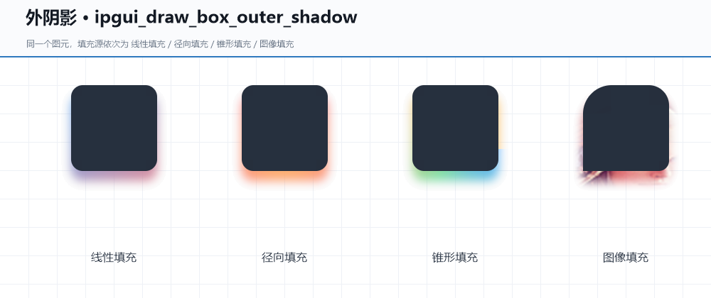

```c
ipgui_aabb_t                    box;
ipgui_box_style_t               bs;
ipgui_box_outer_shadow_style_t  sh;
ipgui_box_bg_style_t            bg;
ipgui_gradient_color_stop_t     s0, s1;

box.start.x = 100;  box.start.y = 120;
box.end.x   = 220;  box.end.y   = 240;

memset(&bs, 0, sizeof(bs));
bs.left_top_radius = 16;  bs.right_top_radius = 16;
bs.left_bottom_radius = 16;  bs.right_bottom_radius = 16;

memset(&sh, 0, sizeof(sh));
sh.blur     = 24;
sh.spread   = 0;
sh.offset_x = 0;
sh.offset_y = 14;
sh.opacity  = 230;

/* 本体：深色，画在阴影上面 */
memset(&bg, 0, sizeof(bg));
bg.paint.type = IPGUI_PAINT_COLOR;
IPGUI_COLOR_SET(bg.paint.src.color, 255, 0x26303E);
bg.opacity    = 255;
bg.blend_mode = IPGUI_BLEND_NORMAL;

/* ① 线性渐变阴影 */
ipgui_liner_gradient_color_t lg;
ipgui_liner_gradient_init_direct(&lg, 70, 120, 250, 300);
IPGUI_COLOR_SET(s0.color, 255, 0x4EAAFF);  s0.pos = 0;
IPGUI_COLOR_SET(s1.color, 255, 0xFF7878);  s1.pos = 255;
ipgui_liner_gradient_add_stop(&lg, &s0);
ipgui_liner_gradient_add_stop(&lg, &s1);

sh.paint.type = IPGUI_PAINT_GRADIENT;
sh.paint.src.grad_src.grad_type = IPGUI_GRADIENT_TYPE_LINEAR;
sh.paint.src.grad_src.grad.liner_grad = lg;

ipgui_draw_box_outer_shadow(&surf, NULL, &box, &bs, &sh);
ipgui_draw_box_background(&surf, NULL, &box, &bs, &bg);

/* ② 图像阴影 */
ipgui_image_src_t isrc;
ipgui_aabb_t      ibox;

ibox.start.x = 300;  ibox.start.y = 110;
ibox.end.x   = 500;  ibox.end.y   = 310;

isrc.img_aabb  = &ibox;
isrc.stride    = 220 * 4;
isrc.buf       = img_buf;
isrc.img_pxfmt = IPGUI_IMG_FMT_RGBA8888;
isrc.px_size   = 4;

sh.paint.type = IPGUI_PAINT_IMAGE;
sh.paint.src.image_src = isrc;

/* 图像填充这一组换成四角不同的半径 */
bs.left_top_radius     = 40;
bs.right_top_radius    = 28;
bs.right_bottom_radius = 14;
bs.left_bottom_radius  = 0;

box.start.x += 240;  box.end.x += 240;
ipgui_draw_box_outer_shadow(&surf, NULL, &box, &bs, &sh);
ipgui_draw_box_background(&surf, NULL, &box, &bs, &bg);
```

---

<a id="api-image"></a>
### 4.10 图像 `ipgui_draw_image`

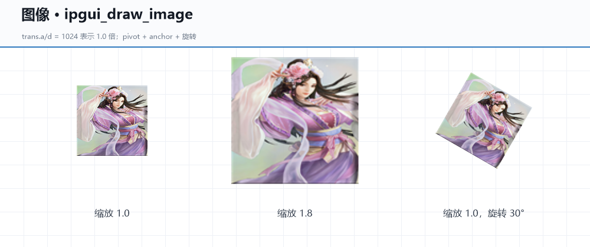

示例图用的是 `material/bmp/diaochan.bmp`（缩成 120×120 的 RGBA8888），三张依次是 1.0 倍、1.8 倍、旋转 30°。

```c
#include <math.h>

ipgui_image_data_t        img;     /* 已加载的图像，120x120 RGBA8888 */
ipgui_point_t             pivot, anchor;
ipgui_trans_mat_t         mat;
ipgui_image_draw_style_t  st;

pivot.x = 60;   pivot.y = 60;      /* 120x120 图像的中心 */

memset(&st, 0, sizeof(st));
st.opacity    = 255;
st.blend_mode = IPGUI_BLEND_NORMAL;

/* 左：1:1 */
mat.a = 1024;   mat.b = 0;
mat.c = 0;      mat.d = 1024;      /* 1024 = 1.0 倍 */
anchor.x = 190; anchor.y = 205;
ipgui_draw_image(&surf, NULL, &img, &pivot, &anchor, &mat, &st,
                 IPGUI_IMAGE_QUALITY_HIGH);

/* 中：放大 1.8 倍 */
mat.a = 1.8 * 1024;
mat.d = 1.8 * 1024;
anchor.x = 500; anchor.y = 205;
ipgui_draw_image(&surf, NULL, &img, &pivot, &anchor, &mat, &st,
                 IPGUI_IMAGE_QUALITY_HIGH);

/* 右：旋转 30°，不缩放 */
double a = 30 * 3.1415926 / 180.0;
mat.a =  cos(a) * 1024;
mat.b = -sin(a) * 1024;
mat.c =  sin(a) * 1024;
mat.d =  cos(a) * 1024;
anchor.x = 820; anchor.y = 205;
ipgui_draw_image(&surf, NULL, &img, &pivot, &anchor, &mat, &st,
                 IPGUI_IMAGE_QUALITY_HIGH);
```

> **注意**：矩阵单位是 **1024 = 1.0**，不是头文件里 26.6 的 64。按 64 算图片会缩到 1/16。

<a id="api-image-api"></a>
#### 便捷接口 `ipgui_draw_image_at` / `_centered` / `_in_rect`

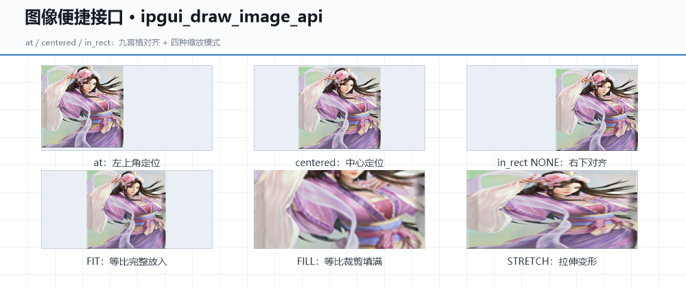

三个封装内部都是调 `ipgui_draw_image`，只是把 pivot / anchor / 矩阵预先算好：

| 接口 | 作用 |
|---|---|
| `ipgui_draw_image_at` | 以 (x, y) 为左上角贴图 |
| `ipgui_draw_image_centered` | 以 (cx, cy) 为中心贴图 |
| `ipgui_draw_image_in_rect` | 在目标矩形内按九宫格对齐并缩放 |

`in_rect` 的 `fit` 有四种：`NONE` 原尺寸、`FIT` 等比完整放入、`FILL` 等比裁剪填满、`STRETCH` 拉伸变形。图里的浅灰框只是容器参考，用来标出对齐边界，不是 API 画的。

```c
ipgui_image_data_t        img;      /* 已加载的图像，120x120 RGBA8888 */
ipgui_image_draw_style_t  st;
ipgui_aabb_t              box;

memset(&st, 0, sizeof(st));
st.opacity    = 255;
st.blend_mode = IPGUI_BLEND_NORMAL;

/* ① 左上角定位 */
ipgui_draw_image_at(&surf, &img, 60, 95, &st, IPGUI_IMAGE_QUALITY_HIGH);

/* ② 中心定位 */
ipgui_draw_image_centered(&surf, &img, 495, 157, &st, IPGUI_IMAGE_QUALITY_HIGH);

/* ③ 矩形内右下对齐，不缩放 */
box.start.x = 680;  box.start.y = 95;
box.end.x   = 929;  box.end.y   = 219;
ipgui_draw_image_in_rect(&surf, &img, &box,
                         IPGUI_IMG_ALIGN_BOTTOM_RIGHT, IPGUI_IMG_FIT_NONE,
                         &st, IPGUI_IMAGE_QUALITY_HIGH);

/* ④ 等比完整放入 */
box.start.x = 60;   box.start.y = 248;
box.end.x   = 309;  box.end.y   = 362;
ipgui_draw_image_in_rect(&surf, &img, &box,
                         IPGUI_IMG_ALIGN_CENTER, IPGUI_IMG_FIT_FIT,
                         &st, IPGUI_IMAGE_QUALITY_HIGH);

/* ⑤ 等比裁剪填满 */
box.start.x = 370;  box.start.y = 248;
box.end.x   = 619;  box.end.y   = 362;
ipgui_draw_image_in_rect(&surf, &img, &box,
                         IPGUI_IMG_ALIGN_CENTER, IPGUI_IMG_FIT_FILL,
                         &st, IPGUI_IMAGE_QUALITY_HIGH);

/* ⑥ 拉伸变形 */
box.start.x = 680;  box.start.y = 248;
box.end.x   = 929;  box.end.y   = 362;
ipgui_draw_image_in_rect(&surf, &img, &box,
                         IPGUI_IMG_ALIGN_CENTER, IPGUI_IMG_FIT_STRETCH,
                         &st, IPGUI_IMAGE_QUALITY_HIGH);
```

图标另有一套 `ipgui_draw_icon_*`，见 [4.12 图标](#api-icon)。

<a id="api-image-tiled"></a>
#### 平铺 `ipgui_draw_image_tiled`

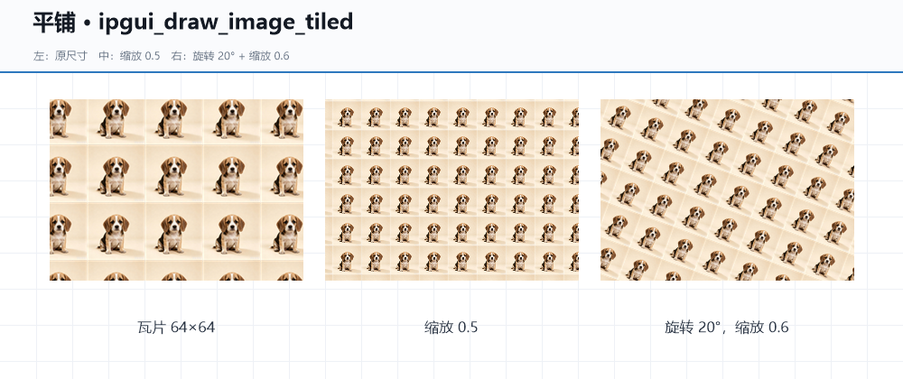

平铺与 `draw_image` 的区别：源坐标按 `[0,w) × [0,h)` 取模循环，绘制区域是 `surf ∩ clip`，所以整块区域都被填满；`trans` 传 `NULL` 就是原尺寸平铺，传变换矩阵就能缩放、旋转。

```c
#include <math.h>

ipgui_image_data_t        img;      /* 已加载的小狗图，64x64 RGBA8888 */
ipgui_aabb_t              r1, r2, r3;
ipgui_point_t             pivot, anchor;
ipgui_trans_mat_t         half, rot;
ipgui_image_draw_style_t  st;

pivot.x = 32;   pivot.y = 32;       /* 64x64 图像的中心 */
anchor.x = 0;   anchor.y = 0;

memset(&st, 0, sizeof(st));
st.opacity    = 255;
st.blend_mode = IPGUI_BLEND_NORMAL;

/* ① 原尺寸平铺：trans 传 NULL 即单位矩阵 */
r1.start.x = 55;   r1.start.y = 110;
r1.end.x   = 335;  r1.end.y   = 310;
ipgui_draw_image_tiled(&surf, &r1, &img, &pivot, &anchor, NULL, &st,
                       IPGUI_IMAGE_QUALITY_HIGH);

/* ② 缩放 0.5 后平铺：tile 从 64px 变成 32px */
half.a = 512;  half.b = 0;          /* 512 / 1024 = 0.5 */
half.c = 0;    half.d = 512;
r2.start.x = 360;  r2.start.y = 110;
r2.end.x   = 640;  r2.end.y   = 310;
ipgui_draw_image_tiled(&surf, &r2, &img, &pivot, &anchor, &half, &st,
                       IPGUI_IMAGE_QUALITY_HIGH);

/* ③ 旋转 20° + 缩放 0.6：每块瓦片跟着转 */
double a = 20 * 3.1415926 / 180.0;
double s = 0.6;
rot.a = (ipgui_scoord_t)( cos(a) * s * 1024);
rot.b = (ipgui_scoord_t)(-sin(a) * s * 1024);
rot.c = (ipgui_scoord_t)( sin(a) * s * 1024);
rot.d = (ipgui_scoord_t)( cos(a) * s * 1024);
r3.start.x = 665;  r3.start.y = 110;
r3.end.x   = 945;  r3.end.y   = 310;
ipgui_draw_image_tiled(&surf, &r3, &img, &pivot, &anchor, &rot, &st,
                       IPGUI_IMAGE_QUALITY_HIGH);
```

> 平铺是每个目标像素反算源坐标再取模，不是"放大后裁剪"。素材本身有接缝时，平铺出来会看到网格线。

---

<a id="api-text"></a>
### 4.11 文字 `ipgui_draw_builtin_text`

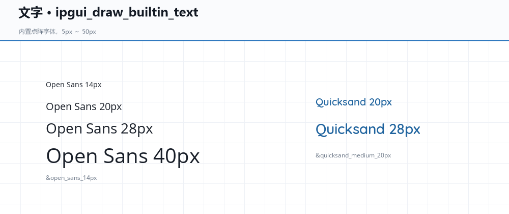

```c
const ipgui_font_t * fonts[4] = {
    &open_sans_14px, &open_sans_20px, &open_sans_28px, &open_sans_40px
};
const char * labels[4] = {
    "Open Sans 14px", "Open Sans 20px", "Open Sans 28px", "Open Sans 40px"
};
int y[4] = { 160, 200, 240, 290 };

for (int i = 0; i < 4; i++) {
    ipgui_font_style_t st;

    memset(&st, 0, sizeof(st));
    st.font            = fonts[i];
    st.paint.type      = IPGUI_PAINT_COLOR;
    IPGUI_COLOR_SET(st.paint.src.color, 255, 0x181E28);
    st.opacity         = 255;
    st.blend_mode      = IPGUI_BLEND_NORMAL;

    ipgui_draw_builtin_text(&surf, NULL, &st, (const s8_t *)labels[i], 90, y[i]);
}

/* 换一套字体：Quicksand，蓝色 */
ipgui_font_style_t qs;

memset(&qs, 0, sizeof(qs));
qs.paint.type = IPGUI_PAINT_COLOR;
IPGUI_COLOR_SET(qs.paint.src.color, 255, 0x1E64A0);
qs.opacity    = 255;
qs.blend_mode = IPGUI_BLEND_NORMAL;

qs.font = &quicksand_medium_20px;
ipgui_draw_builtin_text(&surf, NULL, &qs, (const s8_t *)"Quicksand 20px", 620, 190);

qs.font = &quicksand_medium_28px;
ipgui_draw_builtin_text(&surf, NULL, &qs, (const s8_t *)"Quicksand 28px", 620, 240);

/* 图里的小注记，也是用同一套 API 画的（12px 灰色） */
ipgui_font_style_t note;

memset(&note, 0, sizeof(note));
note.font         = &open_sans_12px;
note.paint.type   = IPGUI_PAINT_COLOR;
IPGUI_COLOR_SET(note.paint.src.color, 255, 0x6C7888);
note.opacity      = 255;
note.blend_mode   = IPGUI_BLEND_NORMAL;

ipgui_draw_builtin_text(&surf, NULL, &note, (const s8_t *)"&open_sans_14px", 90, 344);
ipgui_draw_builtin_text(&surf, NULL, &note, (const s8_t *)"&quicksand_medium_20px", 620, 300);
```

| 能力 | 做法 |
|---|---|
| 渐变文字 | `st.paint.type = IPGUI_PAINT_GRADIENT` |
| 文字阴影 | `ipgui_draw_builtin_text_shadowed()`，`shadow.blur` 控制软硬 |
| 透明度 | `st.opacity` |

内置两套字体、5px–50px 全字号。**字形表只覆盖 ASCII**，中文需要额外字库。

<a id="api-text-fill"></a>
#### 填充源：渐变与图像

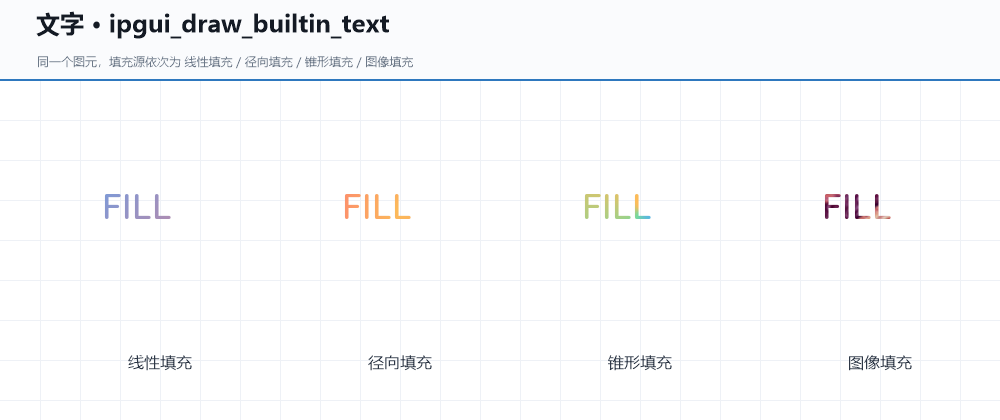

```c
ipgui_font_style_t          st;
ipgui_gradient_color_stop_t s0, s1;

memset(&st, 0, sizeof(st));
st.font       = &quicksand_medium_36px;
st.opacity    = 255;
st.blend_mode = IPGUI_BLEND_NORMAL;

/* ① 线性渐变 */
ipgui_liner_gradient_color_t lg;
ipgui_liner_gradient_init_direct(&lg, 70, 120, 250, 300);
IPGUI_COLOR_SET(s0.color, 255, 0x4EAAFF);  s0.pos = 0;
IPGUI_COLOR_SET(s1.color, 255, 0xFF7878);  s1.pos = 255;
ipgui_liner_gradient_add_stop(&lg, &s0);
ipgui_liner_gradient_add_stop(&lg, &s1);

st.paint.type = IPGUI_PAINT_GRADIENT;
st.paint.src.grad_src.grad_type = IPGUI_GRADIENT_TYPE_LINEAR;
st.paint.src.grad_src.grad.liner_grad = lg;
ipgui_draw_builtin_text(&surf, NULL, &st, (const s8_t *)"FILL", 102, 190);

/* ② 图像填充 */
ipgui_image_src_t isrc;
ipgui_aabb_t      ibox;

ibox.start.x = 300;  ibox.start.y = 110;
ibox.end.x   = 500;  ibox.end.y   = 310;

isrc.img_aabb  = &ibox;
isrc.stride    = 220 * 4;
isrc.buf       = img_buf;
isrc.img_pxfmt = IPGUI_IMG_FMT_RGBA8888;
isrc.px_size   = 4;

st.paint.type = IPGUI_PAINT_IMAGE;
st.paint.src.image_src = isrc;
ipgui_draw_builtin_text(&surf, NULL, &st, (const s8_t *)"FILL", 342, 190);
```

<a id="api-text-shadow"></a>
#### 文字阴影 `ipgui_draw_builtin_text_shadowed`

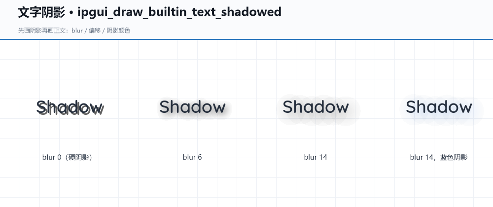

先画阴影再画正文，正文照常由 `font_style` 决定，阴影单独放在 `ipgui_text_shadow_style_t` 里。

```c
ipgui_font_style_t        st;
ipgui_text_shadow_style_t sh;

int cx[4]      = { 140, 390, 640, 890 };
int blur[4]    = { 0, 6, 14, 14 };
int offset[4]  = { 4, 4, 6, 6 };
int colored[4] = { 0, 0, 0, 1 };        /* 最后一个是彩色阴影 */
int tw = ipgui_builtin_text_width(&quicksand_medium_36px, (const s8_t *)"Shadow");

for (int i = 0; i < 4; i++) {
    memset(&st, 0, sizeof(st));
    st.font       = &quicksand_medium_36px;
    st.paint.type = IPGUI_PAINT_COLOR;
    IPGUI_COLOR_SET(st.paint.src.color, 255, 0x26303E);
    st.opacity    = 255;
    st.blend_mode = IPGUI_BLEND_NORMAL;

    memset(&sh, 0, sizeof(sh));
    if (colored[i]) IPGUI_COLOR_SET(sh.color, 255, 0x4E96FF);
    else            IPGUI_COLOR_SET(sh.color, 255, 0x000000);
    sh.opacity    = 160;
    sh.blur       = blur[i];            /* 0 = 硬阴影 */
    sh.offset_x   = offset[i];
    sh.offset_y   = offset[i];
    sh.quality    = IPGUI_TEXT_SHADOW_QUALITY_HIGH;
    sh.blend_mode = IPGUI_BLEND_NORMAL;

    ipgui_draw_builtin_text_shadowed(&surf, NULL, &st, &sh,
                                     (const s8_t *)"Shadow",
                                     cx[i] - tw / 2, 200);
}
```

| 字段 | 说明 |
|---|---|
| `blur` | 模糊半径，0 为硬阴影（偏移复制） |
| `offset_x / offset_y` | 阴影偏移，往右下为正值 |
| `opacity` | 阴影不透明度，低于 3 时直接跳过 |
| `quality` | 模糊遍数：LOW 1 遍 / MEDIUM 2 遍 / HIGH 3 遍 |

阴影是拿字形的覆盖率做 blur 再上色，所以 `blur` 越大越柔和，字本身的抗锯齿不受影响；阴影颜色只影响 `sh.color`，正文颜色仍由 `st.paint` 决定。

---

<a id="api-icon"></a>
### 4.12 图标 `ipgui_draw_icon`

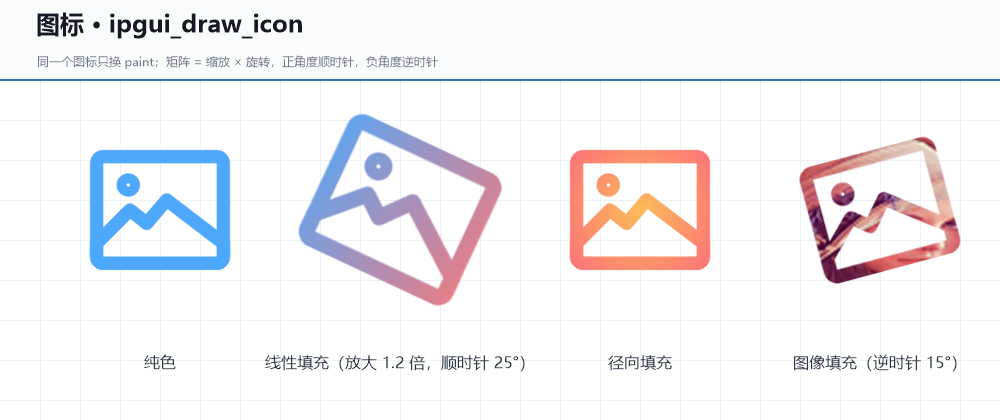

图标和图像的存法不同：`ipgui_icon_data_t` 只有一张 8 位 alpha 蒙版（`w * h` 字节，行主序、不能有行尾 padding），颜色完全由 `style.paint` 决定，所以同一个图标可以随时换纯色、渐变或图片纹理。

```c
#include <math.h>

/* 160x160 的 alpha 蒙版，用 ESDBox_IPGUI/tools/提取png的alpha通道/png_to_icon_mask.py 从 PNG 生成 */
static u8_t              icon_mask[160 * 160];   /* 已填好 alpha */
static ipgui_icon_data_t icon;

icon.w    = 160;
icon.h    = 160;
icon.mask = icon_mask;

ipgui_draw_icon_style_t st;
ipgui_point_t           pivot, anchor;
ipgui_trans_mat_t       mat;
double                  a;

memset(&st, 0, sizeof(st));
st.opacity    = 255;
st.blend_mode = IPGUI_BLEND_NORMAL;

pivot.x = 80;  pivot.y = 80;            /* 160x160 图标的中心 */

/* ① 纯色，1.0 倍 */
st.paint.type = IPGUI_PAINT_COLOR;
IPGUI_COLOR_SET(st.paint.src.color, 255, 0x4EAAFF);
anchor.x = 160;  anchor.y = 210;
ipgui_draw_icon(&surf, NULL, &icon, &pivot, &anchor, NULL, &st);

/* ② 线性填充 + 放大 1.2 倍 + 顺时针 25° */
ipgui_liner_gradient_color_t lg;
ipgui_gradient_color_stop_t  s0, s1;

ipgui_liner_gradient_init_direct(&lg, 300, 130, 500, 290);
s0.pos = 0;    IPGUI_COLOR_SET(s0.color, 255, 0x4EAAFF);
s1.pos = 255;  IPGUI_COLOR_SET(s1.color, 255, 0xFF7878);
ipgui_liner_gradient_add_stop(&lg, &s0);
ipgui_liner_gradient_add_stop(&lg, &s1);

st.paint.type = IPGUI_PAINT_GRADIENT;
st.paint.src.grad_src.grad_type = IPGUI_GRADIENT_TYPE_LINEAR;
st.paint.src.grad_src.grad.liner_grad = lg;

a = 25 * 3.1415926 / 180.0;
mat.a = (ipgui_scoord_t)( cos(a) * 1.2 * 1024);
mat.b = (ipgui_scoord_t)(-sin(a) * 1.2 * 1024);
mat.c = (ipgui_scoord_t)( sin(a) * 1.2 * 1024);
mat.d = (ipgui_scoord_t)( cos(a) * 1.2 * 1024);

anchor.x = 400;  anchor.y = 210;
ipgui_draw_icon(&surf, NULL, &icon, &pivot, &anchor, &mat, &st);

/* ③ 径向填充，1.0 倍 */
ipgui_radial_gradient_color_t rg;

ipgui_radial_gradient_init(&rg, 640, 210, 85);
s0.pos = 0;    IPGUI_COLOR_SET(s0.color, 255, 0xFFBE5A);
s1.pos = 255;  IPGUI_COLOR_SET(s1.color, 255, 0xFF7878);
ipgui_radial_gradient_add_stop(&rg, &s0);
ipgui_radial_gradient_add_stop(&rg, &s1);

st.paint.type = IPGUI_PAINT_GRADIENT;
st.paint.src.grad_src.grad_type = IPGUI_GRADIENT_TYPE_RADIAL;
st.paint.src.grad_src.grad.radial_grad = rg;

anchor.x = 640;  anchor.y = 210;
ipgui_draw_icon(&surf, NULL, &icon, &pivot, &anchor, NULL, &st);

/* ④ 图像填充 + 逆时针 15° */
ipgui_image_src_t isrc;
ipgui_aabb_t      ibox;

ibox.start.x = 780;  ibox.start.y = 110;
ibox.end.x   = 980;  ibox.end.y   = 310;

isrc.img_aabb  = &ibox;
isrc.stride    = 220 * 4;
isrc.buf       = img_buf;
isrc.img_pxfmt = IPGUI_IMG_FMT_RGBA8888;
isrc.px_size   = 4;

st.paint.type = IPGUI_PAINT_IMAGE;
st.paint.src.image_src = isrc;

a = -15 * 3.1415926 / 180.0;      /* 负角度 = 逆时针 */
mat.a = (ipgui_scoord_t)( cos(a) * 1024);
mat.b = (ipgui_scoord_t)(-sin(a) * 1024);
mat.c = (ipgui_scoord_t)( sin(a) * 1024);
mat.d = (ipgui_scoord_t)( cos(a) * 1024);

anchor.x = 880;  anchor.y = 210;
ipgui_draw_icon(&surf, NULL, &icon, &pivot, &anchor, &mat, &st);
```

| 字段 | 说明 |
|---|---|
| `w / h` | 图标尺寸，蒙版必须正好 `w * h` 字节 |
| `mask` | 8 位 alpha，行主序、连续存储，不能有行尾 padding |
| `paint` | 纯色 / 渐变 / 图像，决定图标颜色 |
| `opacity` | 整体不透明度 |

矩阵按屏幕坐标（y 向下）计算：**正角度顺时针、负角度逆时针**。

<a id="api-icon-api"></a>
#### 便捷接口 `ipgui_draw_icon_at` / `_centered` / `_in_rect`

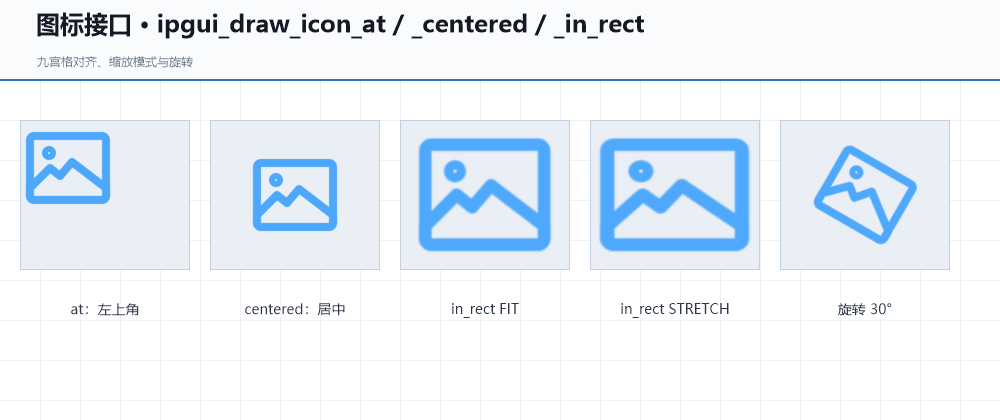

三个封装和图像的 `ipgui_draw_image_at / _centered / _in_rect` 一一对应，只是少了 `quality` 参数。图里的浅灰框同样只是容器参考。

```c
#include <math.h>

ipgui_icon_data_t       icon;      /* 已加载的 96x96 图标 */
ipgui_draw_icon_style_t st;
ipgui_aabb_t            box;
ipgui_point_t           pivot, anchor;
ipgui_trans_mat_t       mat;

memset(&st, 0, sizeof(st));
st.paint.type = IPGUI_PAINT_COLOR;
IPGUI_COLOR_SET(st.paint.src.color, 255, 0x4EAAFF);
st.opacity    = 255;
st.blend_mode = IPGUI_BLEND_NORMAL;

/* ① 左上角 */
ipgui_draw_icon_at(&surf, &icon, 20, 120, &st);

/* ② 中心 */
ipgui_draw_icon_centered(&surf, &icon, 295, 195, &st);

/* ③ 等比完整放入 */
box.start.x = 400;  box.start.y = 120;
box.end.x   = 569;  box.end.y   = 269;
ipgui_draw_icon_in_rect(&surf, &icon, &box,
                        IPGUI_ICON_ALIGN_CENTER, IPGUI_ICON_FIT_FIT, &st);

/* ④ 拉伸变形 */
box.start.x = 590;  box.start.y = 120;
box.end.x   = 759;  box.end.y   = 269;
ipgui_draw_icon_in_rect(&surf, &icon, &box,
                        IPGUI_ICON_ALIGN_CENTER, IPGUI_ICON_FIT_STRETCH, &st);

/* ⑤ 旋转 30°：直接传给 ipgui_draw_icon，矩阵单位同样是 1024 = 1.0 */
pivot.x  = 48;    pivot.y  = 48;      /* 96x96 图标的中心 */
anchor.x = 865;   anchor.y = 195;

double a = 30 * 3.1415926 / 180.0;
mat.a = (ipgui_scoord_t)( cos(a) * 1024);
mat.b = (ipgui_scoord_t)(-sin(a) * 1024);
mat.c = (ipgui_scoord_t)( sin(a) * 1024);
mat.d = (ipgui_scoord_t)( cos(a) * 1024);

ipgui_draw_icon(&surf, NULL, &icon, &pivot, &anchor, &mat, &st);
```

---

<a id="gradient-blend"></a>
## 5. 渐变与混合

<a id="api-gradient"></a>
### 5.1 渐变

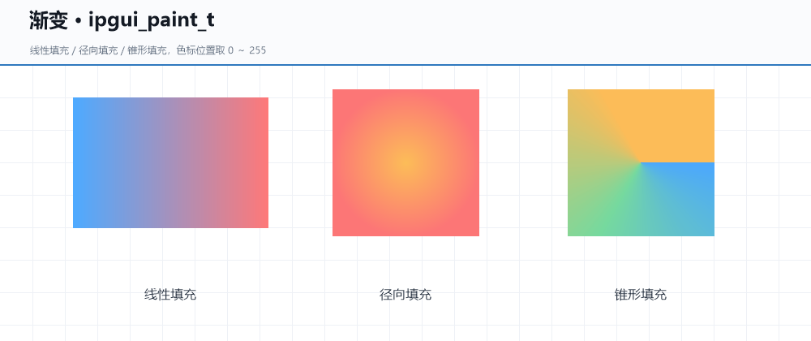

```c
ipgui_paint_t  paint;
ipgui_gradient_color_stop_t s0, s1, s2;

/* 线性：从 (90,0) 到 (330,0) */
ipgui_liner_gradient_color_t lin;
ipgui_liner_gradient_init_direct(&lin, 90, 0, 330, 0);
s0.pos = 0;    IPGUI_COLOR_SET(s0.color, 255, 0x4EAAFF);
s1.pos = 255;  IPGUI_COLOR_SET(s1.color, 255, 0xFF7878);
ipgui_liner_gradient_add_stop(&lin, &s0);
ipgui_liner_gradient_add_stop(&lin, &s1);

/* 共用的矩形与背景样式 */
ipgui_aabb_t         box;
ipgui_box_style_t    bs;
ipgui_box_bg_style_t bg;

memset(&bs, 0, sizeof(bs));
memset(&bg, 0, sizeof(bg));
bg.opacity    = 255;
bg.blend_mode = IPGUI_BLEND_NORMAL;

/* ① 线性 */
box.start.x = 90;   box.start.y = 120;
box.end.x   = 330;  box.end.y   = 280;

paint.type = IPGUI_PAINT_GRADIENT;
paint.src.grad_src.grad_type = IPGUI_GRADIENT_TYPE_LINEAR;
paint.src.grad_src.grad.liner_grad = lin;
bg.paint = paint;
ipgui_draw_box_background(&surf, NULL, &box, &bs, &bg);

/* ② 径向：圆心 (500,200)，半径 90 */
ipgui_radial_gradient_color_t rad;
ipgui_radial_gradient_init(&rad, 500, 200, 90);
s0.pos = 0;    IPGUI_COLOR_SET(s0.color, 255, 0xFFBE5A);
s1.pos = 255;  IPGUI_COLOR_SET(s1.color, 255, 0xFF7878);
ipgui_radial_gradient_add_stop(&rad, &s0);
ipgui_radial_gradient_add_stop(&rad, &s1);

box.start.x = 410;  box.start.y = 110;
box.end.x   = 590;  box.end.y   = 290;

paint.src.grad_src.grad_type = IPGUI_GRADIENT_TYPE_RADIAL;
paint.src.grad_src.grad.radial_grad = rad;
bg.paint = paint;
ipgui_draw_box_background(&surf, NULL, &box, &bs, &bg);

/* ③ 锥形：圆心 (790,200)，起始角 0 */
ipgui_conic_gradient_color_t con;
ipgui_conic_gradient_init(&con, 790, 200, 0);
s0.pos = 0;    IPGUI_COLOR_SET(s0.color, 255, 0x4EAAFF);
s1.pos = 85;   IPGUI_COLOR_SET(s1.color, 255, 0x78DCA0);
s2.pos = 170;  IPGUI_COLOR_SET(s2.color, 255, 0xFFBE5A);
ipgui_conic_gradient_add_stop(&con, &s0);
ipgui_conic_gradient_add_stop(&con, &s1);
ipgui_conic_gradient_add_stop(&con, &s2);

box.start.x = 700;  box.start.y = 110;
box.end.x   = 880;  box.end.y   = 290;

paint.src.grad_src.grad_type = IPGUI_GRADIENT_TYPE_CONIC;
paint.src.grad_src.grad.conic_grad = con;
bg.paint = paint;
ipgui_draw_box_background(&surf, NULL, &box, &bs, &bg);
```

| 类型 | 初始化函数 | `grad_type` |
|---|---|---|
| 线性 | `ipgui_liner_gradient_init_direct(&g, x0, y0, x1, y1)` | `IPGUI_GRADIENT_TYPE_LINEAR` |
| 径向 | `ipgui_radial_gradient_init(&g, cx, cy, r)` | `IPGUI_GRADIENT_TYPE_RADIAL` |
| 锥形 | `ipgui_conic_gradient_init(&g, cx, cy, start_angle)` | `IPGUI_GRADIENT_TYPE_CONIC` |

stop 数量 2–`IPGUI_GRADIENT_STOP_MAX`（默认 15）。线性渐变还有比例模式 `ipgui_liner_gradient_init()`（参数 0.0–1.0），需配合 `_apply_to_aabb()`。

---

<a id="api-blend"></a>
### 5.2 统一填充 `ipgui_blend`

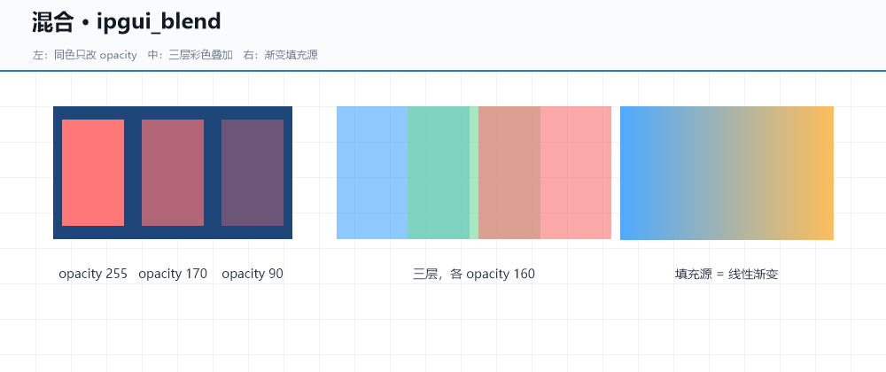

```c
/* 左：深色底 + 三块同色方块，只改 opacity，互不重叠 */
ipgui_aabb_t         base;
ipgui_box_style_t    bstyle;
ipgui_box_bg_style_t bbg;

base.start.x = 60;   base.start.y = 120;
base.end.x   = 330;  base.end.y   = 270;

memset(&bstyle, 0, sizeof(bstyle));
memset(&bbg, 0, sizeof(bbg));
bbg.paint.type = IPGUI_PAINT_COLOR;
IPGUI_COLOR_SET(bbg.paint.src.color, 255, 0x1E4678);
bbg.opacity    = 255;
bbg.blend_mode = IPGUI_BLEND_NORMAL;
ipgui_draw_box_background(&surf, NULL, &base, &bstyle, &bbg);

int op[3] = { 255, 170, 90 };

for (int i = 0; i < 3; i++) {
    ipgui_aabb_t  box;
    ipgui_paint_t paint;

    box.start.x = 70 + i * 90;
    box.start.y = 135;
    box.end.x   = box.start.x + 69;
    box.end.y   = box.start.y + 119;

    paint.type = IPGUI_PAINT_COLOR;
    IPGUI_COLOR_SET(paint.src.color, 255, 0xFF7878);

    ipgui_blend(&surf, NULL, &box, &paint, op[i], NULL, NULL,
                IPGUI_BLEND_NORMAL);
}

/* 中：三种颜色各 160，交错叠在一起看 alpha 累积 */
ipgui_color_t cols[3] = {
    { 78, 170, 255, 255 },
    { 120, 220, 160, 255 },
    { 255, 120, 120, 255 },
};

for (int i = 0; i < 3; i++) {
    ipgui_aabb_t  box;
    ipgui_paint_t paint;

    box.start.x = 380 + i * 80;
    box.start.y = 120;
    box.end.x   = box.start.x + 149;
    box.end.y   = box.start.y + 149;

    paint.type      = IPGUI_PAINT_COLOR;
    paint.src.color = cols[i];

    ipgui_blend(&surf, NULL, &box, &paint, 160, NULL, NULL,
                IPGUI_BLEND_NORMAL);
}

/* 右：渐变 paint 走同一条通路 */
ipgui_gradient_color_stop_t  s0, s1;
ipgui_liner_gradient_color_t lin;
ipgui_aabb_t                 gbox;
ipgui_paint_t                gpaint;

ipgui_liner_gradient_init_direct(&lin, 700, 0, 940, 0);
s0.pos = 0;    IPGUI_COLOR_SET(s0.color, 255, 0x4EAAFF);
s1.pos = 255;  IPGUI_COLOR_SET(s1.color, 255, 0xFFBE5A);
ipgui_liner_gradient_add_stop(&lin, &s0);
ipgui_liner_gradient_add_stop(&lin, &s1);

gbox.start.x = 700;  gbox.start.y = 120;
gbox.end.x   = 940;  gbox.end.y   = 270;

gpaint.type = IPGUI_PAINT_GRADIENT;
gpaint.src.grad_src.grad_type = IPGUI_GRADIENT_TYPE_LINEAR;
gpaint.src.grad_src.grad.liner_grad = lin;

ipgui_blend(&surf, NULL, &gbox, &gpaint, 255, NULL, NULL,
            IPGUI_BLEND_NORMAL);
```

| 模式 | 效果 |
|---|---|
| `IPGUI_BLEND_NORMAL` | 常规 alpha 混合 |
| `IPGUI_BLEND_DODGE` | 颜色减淡 |

`ipgui_blend` 能把任意 paint 画到任意矩形，并且可以挂 8 位蒙版。

> NORMAL 就是标准的 src-over：`结果 = 前景 × opacity + 背景 × (1 - opacity)`。所以同一颜色反复叠加只会越来越接近该颜色，不会无限变深：左边三块 255/170/90 故意互不重叠，是为了单独看 opacity 的作用；要看多层累积，看中间的三种颜色（每层 160），重叠区就是前一层被后一层按 160/255 的比例替换后的结果。

---

<a id="mask"></a>
## 6. 蒙版

<a id="api-mask"></a>
### 6.1 渐变蒙版

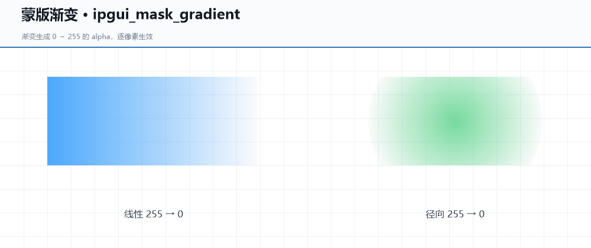

```c
ipgui_mask_gradient_stop_t s0, s1;

/* 线性：从左 255 渐变到右 0 */
ipgui_liner_mask_gradient_t lin;
ipgui_liner_mask_gradient_init_direct(&lin, 80, 0, 440, 0);
s0.pos = 0;     s0.value = 255;
s1.pos = 255;   s1.value = 0;
ipgui_liner_mask_gradient_add_stop(&lin, &s0);
ipgui_liner_mask_gradient_add_stop(&lin, &s1);

for (int x = 0; x < 360; x++) {
    ipgui_aabb_t  col;
    ipgui_paint_t p;
    u8_t          a;

    col.start.x = 80 + x;   col.start.y = 130;
    col.end.x   = 80 + x;   col.end.y   = 279;

    p.type      = IPGUI_PAINT_COLOR;
    IPGUI_COLOR_SET(p.src.color, 255, 0x4EAAFF);

    a = ipgui_liner_mask_gradient_value_at_xy(&lin, 80 + x, 200);
    ipgui_blend(&surf, NULL, &col, &p, a, NULL, NULL, IPGUI_BLEND_NORMAL);
}

/* 径向：圆心 (770,205)，半径 150 */
ipgui_radial_mask_gradient_t rad;
ipgui_radial_mask_gradient_init(&rad, 770, 205, 150);
ipgui_radial_mask_gradient_add_stop(&rad, &s0);
ipgui_radial_mask_gradient_add_stop(&rad, &s1);

for (int y = 0; y < 150; y++) {
    for (int x = 0; x < 300; x++) {
        ipgui_aabb_t  px;
        ipgui_paint_t p;
        u8_t          a;

        px.start.x = px.end.x = 620 + x;
        px.start.y = px.end.y = 130 + y;

        p.type      = IPGUI_PAINT_COLOR;
        IPGUI_COLOR_SET(p.src.color, 255, 0x78DCA0);

        a = ipgui_radial_mask_gradient_value_at_xy(&rad, 620 + x, 130 + y);
        ipgui_blend(&surf, NULL, &px, &p, a, NULL, NULL, IPGUI_BLEND_NORMAL);
    }
}
```

| API | 用途 |
|---|---|
| `..._value_at_xy` | 取某点的 alpha |
| `..._value_get` | 取某个比例位置的 alpha |
| `..._set_opacity` | 整体缩放 |

> **注意**：初始化后必须至少加 2 个 stop，否则所有位置都返回 0，画面全黑且不报错。

<a id="mask-internal"></a>
### 6.2 内部掩码与模糊

以下属于渲染管线内部，通常不直接调用：

| 文件 | 作用 | 使用者 |
|---|---|---|
| `ipgui_ring_mask` | 圆角覆盖率缓存 | `box_background` / `box_border` |
| `ipgui_edge_halfplane_mask` | 单边半平面覆盖率 | 多边形扫描线 |
| `ipgui_edge_wdf_mask` | 距离场边缘覆盖率 | 抗锯齿路径 |
| `ipgui_mask_buf` | 8 位蒙版缓冲 | `ipgui_blend` 的 mask |
| `ipgui_blur` | 分离式 box blur | `box_shadow`、文字阴影 |
| `ipgui_image_mask` / `ipgui_pixel_lerp` | 图像蒙版 / 双线性采样 | `draw_image` 高质量档 |

`ipgui_blur(in, h_kn_size, v_kn_size, passes, out)`：`passes` 取 1/2/3，3 遍最接近高斯。

---

<a id="pixfmt"></a>
## 7. 像素格式

| 格式 | 字节 | 说明 |
|---|---|---|
| `PIX_FMT_RGB565` | 2 | 常见 MCU 屏 |
| `PIX_FMT_BGR565` | 2 | 红蓝对调 |
| `PIX_FMT_RGB888` / `BGR888` | 3 | 24 位 |
| `PIX_FMT_RGBA8888` | 4 | 内存顺序 R G B A |
| `PIX_FMT_ARGB8888` / `ABGR8888` | 4 | alpha 在前 |
| `PIX_FMT_BGRA8888` | 4 | 与 SDL / Windows 位图一致 |

同一套 API 对所有格式通用，内部按 `solid_conv_table` 分发。

---

<a id="perf"></a>
## 8. 性能与限制

1. **裁剪**：`clip` 为 NULL 时按 surface 边界裁剪；局部刷新时传脏矩形。
2. **抗锯齿默认开启**：圆、弧、线、多边形边缘都有覆盖率计算。
3. **阴影/模糊**：分离式 box blur，开销随半径线性增长，不要每帧重算大半径阴影。
4. **渐变**：打开 `IPGUI_GRADIENT_LUT_EN` 多占 64KB，插值更快。
5. **字体**：仅 ASCII；每个字号是独立点阵表，占 Flash。
6. **多边形**：受 `EDGE_EMBED_NUM` 限制，不支持过平的边。
7. **显存**：surface 不要求整屏。把 `surf.surf` 设成屏幕上的条带区域（例如 800×40）、`color` 指向同样大小的缓冲，就能分片渲染，不必开整屏 `fb`。
